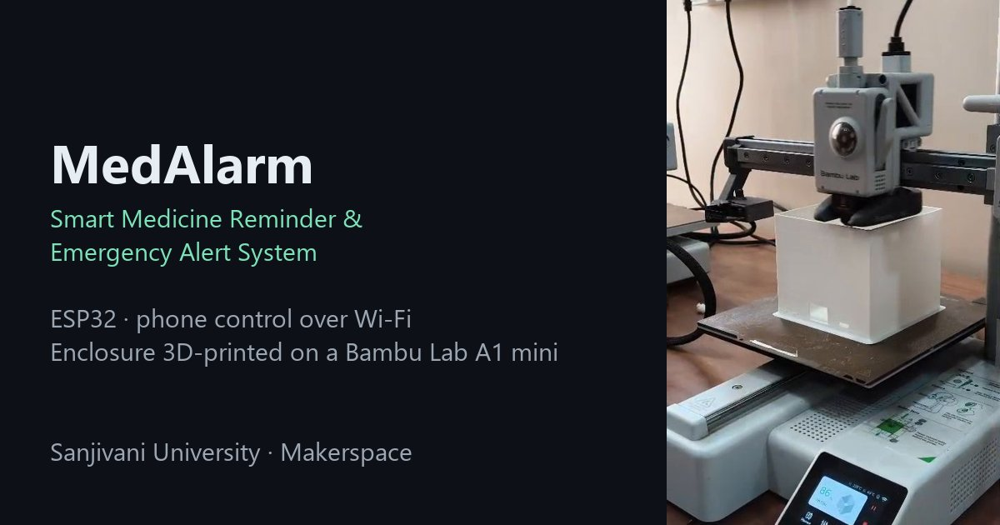

# MedAlarm — Smart Medicine Reminder & Emergency Alert System

**Sanjivani University · Makerspace · FY B.Tech Mechanical Engineering**

A screen-free medicine reminder built on an **ESP32**. The device has no LCD or keypad: it creates its own Wi-Fi network and the medicine name, reminder time and alarm are controlled from any phone browser. A buzzer sounds when the dose is due, a physical button stops it, and an emergency button raises an alert. The enclosure was 3D-printed in PLA on a **Bambu Lab A1 mini**.

**Project website:** https://pranavshelke-77.github.io/Smart-Medicine-Reminder/



## Status

| Stage | Status |
|---|---|
| Screen-free, phone-controlled concept | Done |
| Firmware v1 (one daily reminder) | Written, not yet tested on hardware |
| Enclosure box and lid, Bambu Lab A1 mini | Printed |
| Wiring and soldering into enclosure | In progress |
| Testing | Planned — no results claimed yet |

## Hardware

| Qty | Part | Connection |
|---|---|---|
| 1 | ESP32 DevKit V1 | USB 5 V |
| 1 | Active buzzer (3.3 V, low current) | + → GPIO 25, − → GND |
| 1 | Push button — stop | GPIO 26 ↔ GND (internal pull-up) |
| 1 | Push button — emergency | GPIO 27 ↔ GND (internal pull-up) |
| 1 | 3D-printed PLA enclosure + lid | — |

## Use

1. Upload `firmware/medicine_alarm/medicine_alarm.ino` with the Arduino IDE (ESP32 board package, *ESP32 Dev Module*).
2. On the phone, join Wi-Fi `MedicineAlarm` (password `MedAlarm123` — change it).
3. Open `http://192.168.4.1`, set the device time, then save the medicine name and reminder time.
4. When the buzzer sounds, press the stop button or *Stop buzzer* on the phone.

## Repository

```
index.html                     project website (GitHub Pages)
assets/                        site CSS, JS and icon
firmware/medicine_alarm/       Arduino sketch for the ESP32
docs/                          overview, bill of materials, wiring, 3D printing, testing
data/test-log-template.csv     blank test log
media/photos, media/videos     real build photographs and print videos
```

## Limitations

- One daily reminder; time is lost on power failure (DS3231 RTC planned).
- The emergency alert is shown on the device's status page only — it does not send SMS or call anyone.
- This is a reminder aid, not a medical device.
